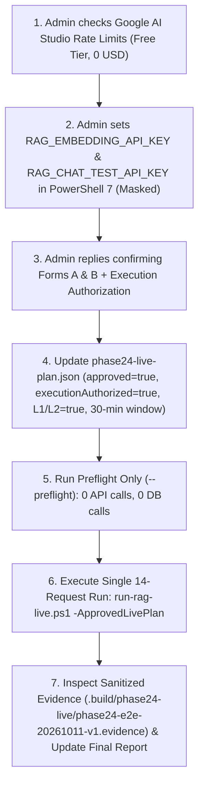

# PHASE 2.4.6 — FINAL LIVE RAG VALIDATION & PRODUCTION READINESS REPORT (WITH FINAL ADMIN APPROVAL CHECKLIST)

- **Project:** `D:\miniproject\fpt`
- **Branch:** `feature/rag-integration` (`HEAD: 48b700f`)
- **Date:** `2026-10-11`
- **Plan ID:** `phase24-e2e-20261011-v1` ([`test/rag/fixtures/phase24-live-plan.json`](file:///d:/miniproject/fpt/test/rag/fixtures/phase24-live-plan.json))
- **Execution Mode:** **OFFLINE PREFLIGHT & AUDIT ONLY** (`realGeminiApiRequests = 0`, `supabaseProductionConnections = 0`)
- **Offline Architecture & Safety Readiness:** **GO (`OFFLINE READY` — 100% Automated Suites PASS)**
- **Immediate Live API Execution Status:** **NO-GO (`LIVE NO-GO` — `approved=false`, `executionAuthorized=false`, `L1`/`L2` `approvedForLive=false`, `RAG_ENABLED=false`)**

---

## 1. Cross-Check: Live Plan JSON vs. Phase 2.4.6 Requirements (Task 1)

Every field in [`test/rag/fixtures/phase24-live-plan.json`](file:///d:/miniproject/fpt/test/rag/fixtures/phase24-live-plan.json) has been cross-checked against [`test/rag/live/LiveSafety.java`](file:///d:/miniproject/fpt/test/rag/live/LiveSafety.java), [`test/rag/live/LiveRagRunner.java`](file:///d:/miniproject/fpt/test/rag/live/LiveRagRunner.java), [`test/rag/live/SinglePostWire.java`](file:///d:/miniproject/fpt/test/rag/live/SinglePostWire.java), and [`test/run-rag-live.ps1`](file:///d:/miniproject/fpt/test/run-rag-live.ps1):

| Audit Item | `phase24-live-plan.json` Field & Value | Runner / Code Enforcement | Alignment Status |
|---|---|---|---|
| **Plan Identifier** | `"planId": "phase24-e2e-20261011-v1"` | `LiveSafety.Plan` (`line 27`: `phase24-[a-zA-Z0-9-]{1,100}`) | **MATCH (`PASS`)** |
| **Primary Chat Model** | `"chatModel": "gemini-3.8-flash"`, `"liveApproval.chatModel": "gemini-3.8-flash"` | `LiveSafety.Plan` (`lines 38, 45`), `LiveRagRunner.Chat` (`line 57`) | **MATCH (`PASS`)** |
| **Primary Thinking Config (Task 3)** | `"liveApproval.thinkingConfig": {"thinkingLevel": "medium"}`, `"thinkingDisabledSupported": false` | `LiveSafety.Plan` (`lines 51–52`), `LiveSafety.Ledger.send()` (`line 136`) | **MATCH (`PASS`)** |
| **Backup Model Disabled in 14-Req Run (Task 4)** | `"backupModelPolicy.backupModel": "gemini-3.5-flash-lite"`, `"enabledDuring14RequestLiveRun": false`, `"extraBudgetRequests": 0` | `LiveSafety.Plan` (`lines 55–65`), `LiveRagRunner.run()` (`line 125` passes `fallback = null`) | **MATCH (`PASS`)** |
| **Embedding Model & Space** | `"embeddingModel": "gemini-embedding-001"`, `"dimensions": 768` | `LiveSafety.Plan` (`line 31`), `LiveSafety.Ledger.send()` (`line 121`), `LiveRagRunner.vector()` (`lines 35–41`) | **MATCH (`PASS`)** |
| **Strict 14-POST Request Budget (Task 6)** | `documentEmbeddingPosts: 2`, `queryEmbeddingPosts: 6`, `chatGenerationPosts: 6`, `maximumExternalRequests: 14`, `metadataGets: 0`, `countTokensRequests: 0`, `retries: 0`, `redirects: 0` | `LiveSafety.Plan` (`lines 35–37`), `LiveSafety.Ledger.send()` (`lines 115–119`), `SinglePostWire` (`lines 18–45`) | **MATCH (`PASS`)** |
| **API Key Environment Variables (Task 8)** | `"embeddingKeyVariable": "RAG_EMBEDDING_API_KEY"`, `"chatKeyVariable": "RAG_CHAT_TEST_API_KEY"` | `LiveSafety.Plan` (`line 32`), `LiveRagRunner.main()` (`line 152` reads only `System.getenv(...)`) | **MATCH (`PASS`)** |
| **Database Isolation & Zero Supabase (Task 9)** | `"host": "127.0.0.1"`, `"name": "fpt_rag_test"`, `"requireNewDedicatedContainer": true`, `"productionAllowed": false` | `LiveSafety.database()` (`line 74`), `LiveRagRunner.verifyDatabase()` (`lines 91–95`), `test/rag-live-database.ps1` | **MATCH (`PASS`)** |
| **Unapproved Governance Locks Preserved** | `"approved": false`, `"executionAuthorized": false`, `"readiness.executable": false`, `L1`/`L2` `"approvedForLive": false` | `LiveSafety.Plan` (`lines 28–29, 67`) blocks execution until explicitly set to `true` | **MATCH (`PASS`)** |

---

## 2. List of Conditions Already Met (`ĐIỀU KIỆN ĐÃ ĐẠT`)

All technical, architectural, security, isolation, and offline regression conditions are **100% met**:

1. **Primary Chat Model & Thinking Compatibility (Task 3):**
   - Exact model `gemini-3.8-flash` with `generationConfig.thinkingConfig = {"thinkingLevel": "medium"}` and `maxOutputTokens = 1200`.
   - `GeminiProvider.buildRequestBody()` omits deprecated `temperature` and `topP` parameters on `gemini-3*` models and attaches `responseMimeType: "application/json"` + `responseJsonSchema`.
   - `GeminiProvider.customerText()` strips internal `"thought": true` reasoning parts so only clean JSON reaches `ConsultationReply.parse()`.
   - `LiveRagRunner.Chat.chat()` validates `0 <= thoughtsTokenCount <= 1200` and `candidatesTokenCount + thoughtsTokenCount <= 1200`.
2. **Backup Model Strictly Disabled in the 14-Request Live Plan (Task 4):**
   - Runtime failover (`gemini-3.5-flash-lite`, `thinkingLevel: "low"`) is implemented for general chatbot resilience, but is **hard-disabled** in the 14-request Live Validation run (`backupModelPolicy.enabledDuring14RequestLiveRun = false`, `extraBudgetRequests = 0`, and `LiveRagRunner.java:125` passes `fallback = null`).
3. **14-POST Request Budget, Zero GET, Zero Retry, Zero Redirect (Task 6):**
   - [`SinglePostWire.java`](file:///d:/miniproject/fpt/test/rag/live/SinglePostWire.java) opens a raw TLS 1.2/1.3 socket with SNI + hostname verification (`generativelanguage.googleapis.com:443`), writes exactly one `POST` request with `Connection: close`, and never follows `3xx` redirects or retries on socket/HTTP errors.
   - [`LiveSafety.Ledger.send()`](file:///d:/miniproject/fpt/test/rag/live/LiveSafety.java#L111-L162) enforces `POST` only, exact allowlisted endpoints (`gemini-embedding-001:embedContent` and `gemini-3.8-flash:generateContent`), and operation allowlist (`document-L1..L2`, `query-LQ1..LQ6`, `chat-LQ1..LQ6`).
   - `LiveRagRunner.Embeddings` blocks `GeminiEmbeddingService`'s default metadata `GET` and retry transport (`DEFAULT_EMBEDDING_TRANSPORT_FORBIDDEN`).
4. **Journal, Execution Lock, Approval Expiry & Anti-Replay Verification (Task 7):**
   - **Orchestration Lock:** [`test/run-rag-live.ps1`](file:///d:/miniproject/fpt/test/run-rag-live.ps1#L26) creates `.build/phase24-orchestration/<planId>.lock` with `FileMode.CreateNew` and `FileShare.None` before starting the test DB or Java runner, and never deletes the lock file.
   - **Cross-Process Request Lock:** [`LiveSafety.Ledger`](file:///d:/miniproject/fpt/test/rag/live/LiveSafety.java#L88-L94) checks that no file in `.build/phase24-live` starts with `<planId>.`, then atomically creates `<planId>.request.lock` with `StandardOpenOption.CREATE_NEW` and flushes `"state": "claimed_no_resume"`.
   - **Pre-Send Immutable Journal:** Before opening any network socket, `Ledger.send()` opens `<operation>.result.json` (`CREATE_NEW`), increments counters (`total++`), and writes + `force(true)` flushes `NN-<operation>.reserved.json` (`01` through `14`). Even if the JVM crashes mid-flight (`Runtime.halt(17)` verified in `LiveRunnerSafetyTest`), the reservation remains on disk and prevents any re-run or resume.
   - **Approval Window & Per-Send Expiry Check:** `LiveSafety.Plan` (`line 44`) requires `verifiedAtEpochMs <= now`, `expiresAtEpochMs > now`, and `expiresAtEpochMs - verifiedAtEpochMs <= 1,800,000` ms (`<= 30 minutes`). Furthermore, `Plan.beforeSend()` (`line 72`) re-checks `System.currentTimeMillis() < expiresAtEpochMs` **after** each 65-second rate-limit wait (`awaitModel`) and immediately before every network send.
   - **Preservation of Historical Evidence:** `97/97` files in `.build/phase242-preserve-e5fd204e3c94450abccf7a10bc616e7f.json` and `14/14` Phase 2.3 probe artifacts remain 100% identical by SHA-256 and UTC timestamp. Current plan locks (`.build/phase24-live/phase24-e2e-20261011-v1.request.lock` and `.build/phase24-orchestration/phase24-e2e-20261011-v1.lock`) do **not** exist yet (`False`).
5. **Safe Environment-Variable Key Injection & Zero Production Key Access (Task 8):**
   - `LiveRagRunner.main()` (`line 152`) reads **only** `System.getenv("RAG_EMBEDDING_API_KEY")` and `System.getenv("RAG_CHAT_TEST_API_KEY")`.
   - It never reads `.local/runtime.json`, `SettingsDAO`, `GEMINI_API_KEY`, or `GOOGLE_API_KEY` (verified by child-process test `main never falls back to production environment key` in `LiveRunnerSafetyTest.java:104`).
6. **Zero Supabase Production Connection or Modification (Task 9):**
   - `LiveSafety.database()` (`line 74`) rejects any host other than `"127.0.0.1"` and any database name other than `"fpt_rag_test"`.
   - `test/rag-live-database.ps1` provisions a brand-new local Docker container (`postgres:17-pgvector0.8.2`), verifies container ID, label `com.fpt.rag.test=true`, loopback port mapping, and 32-hex nonce in `phase241_test_identity`, and confirms `0` existing rows in `knowledge_documents` and `knowledge_chunks`.
   - Supabase production was accessed **0 times** across all phases.
7. **Complete Offline Test & Mock E2E Verification:**
   - `review-rag-phase24-plan.ps1`: **PASS** (`2+6+6=14` budget, `29/29` x2 mock reruns, `14` Phase 2.3 artifacts unchanged).
   - `test-rag-live-runner.ps1`: **87/87 PASS** (`0` failed, `0` real API calls).
   - `test-rag-live-entry.ps1`: **4/4 PASS** (syntax `5/5 PASS`).
   - `test-rag-live-isolation.ps1`: **4/4 PASS**.
   - `test-rag-live-database.ps1`: **7/7 DB safety assertions PASS** + **6/6 `LQ1`–`LQ6` mock E2E PASS** (`Recall@3 = 4/4`, `Mean Precision@3 = 0.875 >= 0.80`, `Abstentions = 2/2`, `14` mock requests, `0` real API calls).

---

## 3. List of Unmet Conditions Pending Administrator Input (`ĐIỀU KIỆN CHƯA ĐẠT — CHỜ ADMIN XÁC NHẬN`)

Only the **4 mandatory Administrator Governance & Environment Conditions** remain unmet (by design, as offline preparation is forbidden from self-approving):

| # | Unmet Condition | Current Value in Plan / Environment | Required Value for `GO` |
|---|---|---|---|
| **U1** | **Google AI Studio Free Tier & Remaining Quota Confirmation (`cost.*`, `quota.*`, `liveApproval.*`)** | `currentProjectTierVerifiedForThisPlan: false`, `quota.verifiedForThisPlan: false`, `embeddingTier: null`, `chatTier: null`, `embeddingRpdRemaining: null`, `chatRpdRemaining: null`, `embeddingRpmRemaining: null`, `chatRpmRemaining: null`, `embeddingTpmRemaining: null`, `chatTpmRemaining: null` | `"Free Tier"` confirmed for both models; `embeddingRpdRemaining >= 8`, `embeddingRpmRemaining >= 1`, `embeddingTpmRemaining >= 2048`; `chatRpdRemaining >= 6`, `chatRpmRemaining >= 1`, `chatTpmRemaining >= 17648`; `paidRequestsAllowed = false`, `maximumApprovedPaidCostUsd = 0`. |
| **U2** | **Corpus `L1` & `L2` Live Test Approval (`documents[0..1].approvedForLive`)** | `L1.approvedForLive = false`, `L2.approvedForLive = false` | Administrator confirms `L1.approvedForLive = true` and `L2.approvedForLive = true` for the isolated test container `fpt_rag_test`. |
| **U3** | **Dedicated Test API Keys in Executing PowerShell 7 Session** | `RAG_EMBEDDING_API_KEY` (`False` in current process), `RAG_CHAT_TEST_API_KEY` (`False` in current process) | Both environment variables exported in the Administrator's executing PowerShell 7 (`pwsh`) window (`True` / `True`). |
| **U4** | **Final Execution Authorization & 30-Minute Approval Timestamp Window** | `approved: false`, `executionAuthorized: false`, `readiness.executable: false`, `verifiedAtEpochMs: null`, `expiresAtEpochMs: null` | Administrator authorizes setting `approved = true`, `executionAuthorized = true`, `readiness.executable = true`, `readiness.blockers = []`, and a 30-minute timestamp window (`expiresAtEpochMs - verifiedAtEpochMs <= 1800000`). |

---

## 4. Guide & Form: Verifying Free Tier & Quota in Google AI Studio (Task 2)

### 4.1 Step-by-Step Verification in Google AI Studio (`0` API Calls)

1. **Verify Project & Free Tier Status:**
   - Open `https://aistudio.google.com/apikey`.
   - Identify the Google Cloud project(s) corresponding to `RAG_EMBEDDING_API_KEY` and `RAG_CHAT_TEST_API_KEY` (must **not** be the production project/key).
   - Check the **Plan / Tier** column: confirm it displays **`Free`** / **`Free tier`** (no active pay-as-you-go billing attached, guaranteeing `0 USD` paid cost).
2. **Verify Remaining Quotas (`RPD`, `RPM`, `TPM`):**
   - Open `https://aistudio.google.com/rate-limit` and select the test Google Cloud project in the top dropdown.
   - Locate **`gemini-embedding-001`** and calculate `Remaining = Limit - Current Usage`:
     - **RPD remaining:** must be **`>= 8`** (`2` document embeddings + `6` query embeddings)
     - **RPM remaining:** must be **`>= 1`** (runner spaces embedding requests by `>= 65,000 ms`)
     - **TPM remaining:** must be **`>= 2,048`** (`<= 2,048` UTF-8 byte + 64 bound per request)
   - Locate **`gemini-3.8-flash`** and calculate `Remaining = Limit - Current Usage`:
     - **RPD remaining:** must be **`>= 6`** (`6` chat generation calls)
     - **RPM remaining:** must be **`>= 1`** (runner spaces chat requests by `>= 65,000 ms`)
     - **TPM remaining:** must be **`>= 17,648`** (`chatInputByteCap 16,384 + chatMaxOutputTokens 1,200 + 64`)
3. **Keep Project Quiet During Execution:**
   - Do not run AI Studio playground prompts or other scripts in the same Google Cloud project during the ~10-minute serial test run.

### 4.2 Administrator Free Tier & Quota Confirmation Form (Copy & Fill)

```markdown
### [FORM A] XÁC NHẬN FREE TIER & QUOTA (GOOGLE AI STUDIO)
- [ ] Dedicated Test Keys Confirmed (`dedicatedTestKeysConfirmed`): true (không dùng chung key production)
- [ ] Maximum Approved Paid Cost: 0 USD (`paidRequestsAllowed = false`)

1. Embedding Model (`gemini-embedding-001`, 768 dimensions):
   - Tier (`embeddingTier`): Free Tier
   - Remaining RPD (`embeddingRpdRemaining`, yêu cầu >= 8): ______
   - Remaining RPM (`embeddingRpmRemaining`, yêu cầu >= 1): ______
   - Remaining TPM (`embeddingTpmRemaining`, yêu cầu >= 2048): ______

2. Primary Chat Model (`gemini-3.8-flash`, `thinkingConfig: {"thinkingLevel": "medium"}`, `maxOutputTokens: 1200`):
   - Tier (`chatTier`): Free Tier
   - Remaining RPD (`chatRpdRemaining`, yêu cầu >= 6): ______
   - Remaining RPM (`chatRpmRemaining`, yêu cầu >= 1): ______
   - Remaining TPM (`chatTpmRemaining`, yêu cầu >= 17648): ______
   - Backup Model (`gemini-3.5-flash-lite`) trong kế hoạch 14 request: TẮT (`enabledDuring14RequestLiveRun = false`, `extraBudgetRequests = 0`)
```

---

## 5. Corpus `L1` & `L2` Confirmation Form (Isolated Test PostgreSQL Only — Task 5)

Both documents below will be indexed **exclusively** into the disposable local Docker PostgreSQL container (`127.0.0.1:<random_port>/fpt_rag_test`), never into Supabase production:

| ID | Title | Exact Content to Embed (`UTF-8`) | Source File | Provenance & Scope | Chunks | Business Conflict |
|---|---|---|---|---|---:|---|
| **`L1`** | `Hướng dẫn kết nối mạng WiFi` | `"Anh/chị kiểm tra kết nối dây mạng an toàn trước khi liên hệ hỗ trợ."` | `test/rag/RagQualityTest.java` | Synthetic QA troubleshooting text (`authority: "admin_reviewed"`, **not** labeled `official` FPT policy) | `1` | **None** (`0` prices/speeds/fees) |
| **`L2`** | `Hướng dẫn chơi game` | `"Với nhu cầu chơi game, anh/chị nên ưu tiên kết nối dây LAN; tốc độ gói không bảo đảm ping hay độ trễ thực tế."` | `src/java/ai/consultation/ConsultationPolicy.java` | Existing customer consultation guidance (`authority: "admin_reviewed"`, aligned with `ConsultationPolicy`) | `1` | **None** (`0` prices/speeds/fees) |

### Administrator Corpus Confirmation Form (Copy & Fill)

```markdown
### [FORM B] XÁC NHẬN CORPUS KIỂM THỬ (`L1` & `L2`)
- [ ] Phê duyệt `L1` (`approvedForLive = true`): "Anh/chị kiểm tra kết nối dây mạng an toàn trước khi liên hệ hỗ trợ." (1 chunk, chỉ nạp vào PostgreSQL test cô lập `127.0.0.1 / fpt_rag_test`, không phải chính sách chính thức FPT)
- [ ] Phê duyệt `L2` (`approvedForLive = true`): "Với nhu cầu chơi game, anh/chị nên ưu tiên kết nối dây LAN; tốc độ gói không bảo đảm ping hay độ trễ thực tế." (1 chunk, chỉ nạp vào PostgreSQL test cô lập `127.0.0.1 / fpt_rag_test`)
- [ ] Xác nhận không ghi dữ liệu test vào Supabase production (`productionAllowed = false`)
```

---

## 6. Guide: Configuring Test API Keys Safely in PowerShell 7 (Task 8)

To prevent API keys from ever appearing in chat logs, command history files, or git-tracked files, configure `RAG_EMBEDDING_API_KEY` and `RAG_CHAT_TEST_API_KEY` in your dedicated **PowerShell 7 (`pwsh`)** window using interactive masked input (`Read-Host -AsSecureString`):

```powershell
# 1. Mở PowerShell 7 (pwsh) tại thư mục dự án:
Set-Location -LiteralPath 'D:\miniproject\fpt'

# 2. Cấu hình môi trường kiểm thử cô lập (RAG production luôn tắt):
$env:RAG_ENVIRONMENT = 'development'
$env:RAG_ENABLED = 'false'

# 3. Nhập từng API key test ở chế độ ẩn ký tự (không lưu vào PSReadLine history và không in ra màn hình):
$embedSec = Read-Host -Prompt 'Nhập RAG_EMBEDDING_API_KEY (Test Key)' -AsSecureString
$env:RAG_EMBEDDING_API_KEY = [Runtime.InteropServices.Marshal]::PtrToStringBSTR(
    [Runtime.InteropServices.Marshal]::SecureStringToBSTR($embedSec)
)

$chatSec = Read-Host -Prompt 'Nhập RAG_CHAT_TEST_API_KEY (Test Key)' -AsSecureString
$env:RAG_CHAT_TEST_API_KEY = [Runtime.InteropServices.Marshal]::PtrToStringBSTR(
    [Runtime.InteropServices.Marshal]::SecureStringToBSTR($chatSec)
)

# 4. Xác minh 2 biến đã tồn tại (CHỈ in True/False và độ dài, tuyệt đối không in giá trị key):
[pscustomobject]@{
    RAG_ENVIRONMENT          = $env:RAG_ENVIRONMENT
    RAG_ENABLED              = $env:RAG_ENABLED
    EmbeddingKeyPresent      = [bool]$env:RAG_EMBEDDING_API_KEY
    EmbeddingKeyValidLength  = ($env:RAG_EMBEDDING_API_KEY.Length -ge 7 -and $env:RAG_EMBEDDING_API_KEY.Length -le 512)
    ChatTestKeyPresent       = [bool]$env:RAG_CHAT_TEST_API_KEY
    ChatTestKeyValidLength   = ($env:RAG_CHAT_TEST_API_KEY.Length -ge 7 -and $env:RAG_CHAT_TEST_API_KEY.Length -le 512)
} | Format-List
```

---

## 7. Summary of Information Required from Administrator to Reach `GO` (Task 10)

To transition from **NO-GO** to **GO**, the Administrator only needs to reply with (or confirm) the following **5 items**:

1. **Embedding Quota (`gemini-embedding-001`):** Confirm `Free Tier` and provide remaining `RPD` (`>= 8`), `RPM` (`>= 1`), `TPM` (`>= 2048`).
2. **Primary Chat Quota (`gemini-3.8-flash`, `thinkingLevel = medium`):** Confirm `Free Tier` and provide remaining `RPD` (`>= 6`), `RPM` (`>= 1`), `TPM` (`>= 17648`), with `paidRequestsAllowed = false` (`0 USD` max paid cost) and Backup Model (`gemini-3.5-flash-lite`) disabled during the 14-request run.
3. **Corpus `L1` & `L2` Approval:** Confirm `L1.approvedForLive = true` and `L2.approvedForLive = true` for the isolated local test container `127.0.0.1 / fpt_rag_test`.
4. **PowerShell Test Keys Confirmation:** Confirm `RAG_EMBEDDING_API_KEY` and `RAG_CHAT_TEST_API_KEY` are set (`True` / `True`) in the executing PowerShell 7 window and are dedicated test keys.
5. **Final Execution Authorization:** Explicitly authorize setting `approved = true` and `executionAuthorized = true` (with a 30-minute timestamp window) in [`test/rag/fixtures/phase24-live-plan.json`](file:///d:/miniproject/fpt/test/rag/fixtures/phase24-live-plan.json) and executing the single 14-request run.

---

## 8. Final Approval & Execution Workflow



### Exact Commands After Administrator Sign-Off

1. **Step 1 (After Admin approval updates `phase24-live-plan.json`):** Run offline Java preflight in the PowerShell 7 window (`0` network/DB calls) to confirm the approved JSON and environment keys pass all gates:
   ```powershell
   java '-Dfile.encoding=UTF-8' -cp ".build/phase241-test-classes;.build/web/WEB-INF/classes;lib/runtime/*;lib/compile-only/*" rag.live.LiveRagRunner --preflight "D:\miniproject\fpt\test\rag\fixtures\phase24-live-plan.json"
   ```
2. **Step 2:** Execute the single locked 14-request Live Validation run (`2` doc embeddings + `6` query embeddings + `6` chat calls, spaced `>= 65s` per model):
   ```powershell
   pwsh -NoProfile -File 'D:\miniproject\fpt\test\run-rag-live.ps1' -ApprovedLivePlan -PlanPath 'D:\miniproject\fpt\test\rag\fixtures\phase24-live-plan.json'
   ```

---

## 9. Final GO / NO-GO Status

- **Offline Technical, Safety & Isolation Readiness:** **GO (`OFFLINE READY`)**
- **Live Gemini API Execution Status:** **NO-GO (`LIVE NO-GO` — Held Before Any Real API Request)**
  - `realGeminiApiRequests = 0`
  - `approved = false`
  - `executionAuthorized = false`
  - `L1.approvedForLive = false`, `L2.approvedForLive = false`
  - `RAG_ENABLED = false`
  - Waiting for Administrator confirmation of Section 7.
